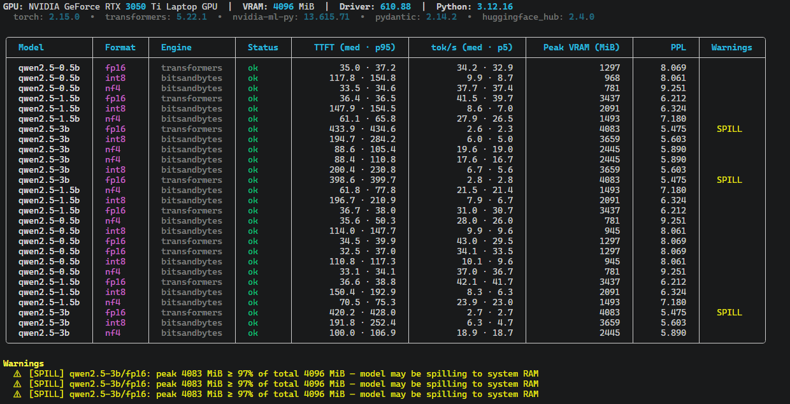

<div align="center">
  
# quantbench

A benchmarking tool designed to measure **speed (TTFT, tokens/s)**, **VRAM footprint**, and **quality (multi-domain Perplexity)** of Large Language Models across quantization formats on small-VRAM NVIDIA GPUs (focus: ~4 GB).

<br>


</div>

---

## 🎯 The Core Problem
4 GB VRAM (typical of budget laptop GPUs) represents the strictest boundary for running local LLMs. Practitioners on constrained hardware face a fundamental trade-off:
> *Should you run a small model at full FP16 precision, or quantize a larger, more capable model to 4-bit/8-bit to fit into memory?*

`quantbench` was built to provide an **honest, reproducible, and scientifically controlled benchmark** on consumer hardware.

---
## 🚀 Headline Findings
Benchmarked on **NVIDIA GeForce RTX 3050 Ti Laptop GPU (4096 MiB VRAM)** across **Qwen2.5 (0.5B, 1.5B, 3B)**:
1. **The 4-bit Sweet Spot — 3B NF4 is the Champion:**
   * **Quality over Precision:** Qwen2.5-3B NF4 achieves an overall perplexity of **5.890**, comfortably outperforming Qwen2.5-1.5B FP16 (**6.212**) and Qwen2.5-0.5B FP16 (**8.069**).
   * **Smooth Throughput:** Fits in only **2,445 MiB VRAM** and generates at **~18–20 tokens/s** with low first-token latency (~88 ms).
   * *Conclusion:* **A larger quantized model decisively beats a smaller unquantized model.**
2. **The INT8 Dequantization Tax:**
   * bitsandbytes `LLM.int8()` preserves FP16 perplexity almost losslessly (e.g., 0.5B FP16 PPL 8.069 vs INT8 PPL 8.061).
   * However, dynamic dequantization and outlier management impose a **4–5× speed penalty**, collapsing generation speeds to **~6–10 tokens/s** and inflating TTFT.
3. **PCIe Memory Spillover Detection (`[SPILL]`):**
   * Qwen2.5-3B FP16 requires more VRAM than the 4096 MiB physical capacity. It allocates **4,083 MiB**, spilling active layers to system RAM over the PCIe bus.
   * `quantbench`'s automated spill detection flags this condition: throughput collapses to **2.6–2.8 tokens/s** and TTFT jumps to **>400 ms**.

---

## 🔬 Methodology & Architectural Decisions
`quantbench` was engineered around scientific reproducibility and controlled variables:
### 1. Single-Engine Variable Isolation
To measure the true isolated effect of quantization formats (FP16 vs. INT8 vs. NF4), the runtime engine must remain constant. Comparing PyTorch FP16 against C++ `llama.cpp` GGUF conflates quantization efficiency with runtime language optimizations. In v0.1, all models run within the **PyTorch / Hugging Face Transformers** ecosystem with **bitsandbytes**.
### 2. Multi-Pass Alternating Execution
Laptop GPUs feature aggressive Dynamic Voltage and Frequency Scaling (DVFS). Running all tests sequentially from smallest to largest would unfairly penalize larger models with higher operating temperatures.  
* `quantbench` runs **3 complete passes with alternating matrix order** (`0.5B ➔ 3B`, then `3B ➔ 0.5B`, then `0.5B ➔ 3B`).
* Results are summarized using **median** and **Slow-side throughput (p5)** (representing worst-case user experience) rather than unweighted arithmetic averages.
### 3. Multi-Domain Token-Weighted Perplexity
Evaluating model perplexity on a single prompt introduces heavy domain bias. `quantbench` computes log-likelihood across **4 distinct domains**:
* **Narrative:** Creative prose (`prompt.txt`)
* **Code:** Algorithmic Python implementation (`code.txt`)
* **Reasoning:** Step-by-step logic puzzle (`reasoning.txt`)
* **Factual:** Scientific text (`nature.txt`)

Rather than calculating a naive mean of per-prompt perplexities, overall quality is aggregated via **token-weighted log-likelihood**:  

```math
\text{PPL}_{\text{overall}} = \exp\left( -\frac{\sum_{i} \sum_{t} \log P(x_{i,t})}{\sum_{i} N_i} \right)
```

---

### 4. Process Isolation & VRAM Leak Protection
The orchestrator never touches CUDA in the parent process. Every single `(model, variant)` job is executed in an isolated, short-lived worker subprocess. This guarantees:
* Zero CUDA memory fragmentation between runs.
* An immaculate baseline VRAM reading before model weight initialization.
* Safe recovery from Out-Of-Memory (`BackendOOMError`) crashes.
---

## 🛠️ Architecture

| Component | Path | Responsibility |
|:---|:---|:---|
| **Backends** | `src/quantbench/backends/` | Model loading & generation (FP16 greedy, bitsandbytes INT8 & NF4). Never measures anything. |
| **Measurement** | `src/quantbench/measure/` | Backend-agnostic measurement (GPU sampler via NVML, baseline VRAM, latency timer, multi-domain PPL). |
| **Orchestration** | `src/quantbench/orchestrator.py`<br>`src/quantbench/worker.py` | Matrix coordination, process isolation per job, report assembly. Never touches CUDA in the parent process. |
| **CLI & Report** | `src/quantbench/cli.py`<br>`src/quantbench/report/` | Typer CLI interface (`fetch`, `run`, `show`) and Rich terminal table rendering with automated warning detection. |
| **Contracts & Stats**| `src/quantbench/schema.py`<br>`src/quantbench/stats.py` | Pydantic v2 strict models and robust statistical utilities (`median`, `p95`, `p5`). |
---

* **Separation of Concerns:** Backends never measure anything; the measurement layer knows nothing about model architectures; the report layer only consumes validated report JSONs.

---

## 📊 Benchmark Results

Full campaign output across 3 passes in alternating order (27 runs), rendered directly by `quantbench show`:  



---

## ⚡ Quickstart
### Prerequisites
* NVIDIA GPU with driver installed (tested on RTX 3050 Ti Mobile)
* Python 3.12+
* uv (recommended package manager)

### 1. Installation
Clone the repository and synchronize dependencies:
```bash
git clone https://github.com/kadircancelik/quantbench.git
cd quantbench
uv sync
```
### 2. Fetch Models
Download the benchmark models locally into models/:
```bash
uv run quantbench fetch
```

### 3. Run Benchmark
Run the full matrix (or select specific models/variants):
```bash
# Run full 3-pass campaign
uv run quantbench run

# Or run specific models with reverse ordering
uv run quantbench run -m qwen2.5-3b -v nf4 --reverse 3
```

### 4. Inspect Results
Render the rich terminal summary table:

```bash
uv run quantbench show results/report-<timestamp>.json
```

## 🧪 Testing

The test suite covers pure logic, statistics, and schema validation without requiring an active GPU:

```bash
uv run pytest
```
